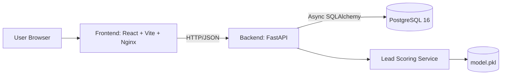

# LivoCRM Architecture Overview

## 1. Purpose
LivoCRM is a full-stack CRM application with:
- A FastAPI backend (`backend/app`) exposing REST APIs.
- A React + TypeScript frontend (`frontend/src`) providing dashboard, contacts, pipeline, and settings UI.
- A PostgreSQL database managed by SQLAlchemy + Alembic.
- A local ML scoring pipeline (`backend/ml`) for lead scoring.

## 2. High-Level System Architecture

## 3. Runtime and Deployment
- Local orchestration is defined in `docker-compose.yml`.
- Services:
- `db`: `postgres:16-alpine`, persistent volume `pgdata`.
- `backend`: Python 3.12 container, runs Alembic migrations then starts Uvicorn.
- `frontend`: Node build stage + Nginx runtime serving static assets.

## 4. Backend Structure
- Entry point: `backend/app/main.py`
- Database base/session: `backend/app/database.py`
- Config/env settings: `backend/app/config.py`
- Auth/session dependencies: `backend/app/dependencies.py`
- Domain models: `backend/app/models/`
- API routers: `backend/app/routers/`
- Pydantic schemas: `backend/app/schemas/`
- Services:
- Auth: `backend/app/services/auth_service.py`
- Lead scoring: `backend/app/services/lead_scoring.py`

## 5. Frontend Structure
- App bootstrap: `frontend/src/main.tsx`
- Router: `frontend/src/App.tsx`
- API client wrappers: `frontend/src/api/`
- Pages: `frontend/src/pages/`
- Layout shell: `frontend/src/components/layout/`
- State stores (Zustand): `frontend/src/stores/`
- Shared types: `frontend/src/types/index.ts`

## 6. Data and Migration
- Alembic env: `backend/alembic/env.py`
- Initial migration: `backend/alembic/versions/0001_initial.py`
- Core tables:
- `users`
- `contacts`
- `deals`
- `activities`
- `pipeline_stages`

See `docs/DATABASE_SCHEMA_AND_ERD.md` for full schema and ERD.

## 7. AI/ML Scope in This Codebase
- Offline model training scripts:
- `backend/ml/generate_data.py`
- `backend/ml/train_scorer.py`
- Inference endpoint:
- `GET /api/ai/score/{contact_id}`
- AI insights endpoint is currently placeholder text:
- `POST /api/ai/insights`

## 8. Important Integration Notes (Current State)
The frontend and backend are not fully contract-aligned yet.

- Backend auth routes are `/api/auth/*`, but frontend auth client calls `/users/*` routes.
- Backend entity IDs are UUIDs, but frontend types mostly define IDs as numeric.
- Backend list endpoints return raw arrays; frontend expects paginated payloads (`{count,next,previous,results}`).
- Backend deal stages are strings (`lead`, `qualified`, etc.); frontend pipeline uses numeric stage IDs and separate stage APIs.
- Sidebar/command menu include `/analytics` route, but `App.tsx` has no route for `/analytics`.

This documentation reflects the code exactly as implemented at the time of analysis.
