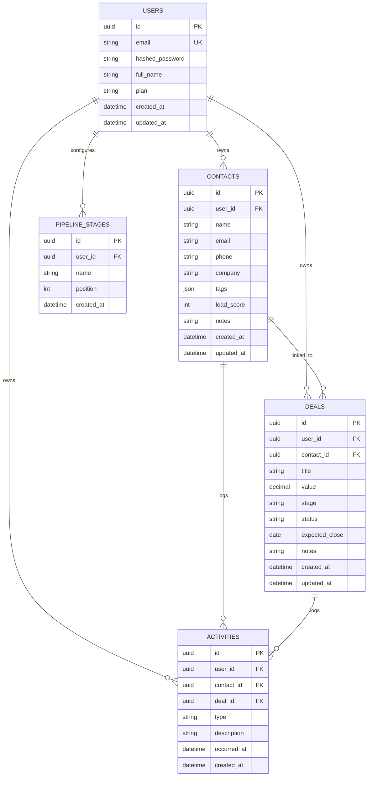

# Database Schema and ER Diagram

## 1. Database Engine and Access
- Engine: PostgreSQL 16 (Docker)
- ORM: SQLAlchemy async models
- Migration tooling: Alembic
- Migration source of truth:
- `backend/alembic/versions/0001_initial.py`

## 2. Tables

### 2.1 `users`
Primary columns:
- `id` UUID PK, default `gen_random_uuid()`
- `email` VARCHAR(255), unique, indexed, non-null
- `hashed_password` TEXT, non-null
- `full_name` VARCHAR(255), non-null, default empty
- `plan` VARCHAR(20), non-null, default `free`
- `created_at` TIMESTAMPTZ, default `now()`
- `updated_at` TIMESTAMPTZ, default `now()`

### 2.2 `contacts`
Primary columns:
- `id` UUID PK
- `user_id` UUID FK -> `users.id` ON DELETE CASCADE
- `name` VARCHAR(255), non-null
- `email` VARCHAR(255), default empty
- `phone` VARCHAR(50), default empty
- `company` VARCHAR(255), default empty
- `tags` JSON, default `[]`
- `lead_score` INTEGER, default `0`
- `notes` TEXT, default empty
- `created_at` TIMESTAMPTZ
- `updated_at` TIMESTAMPTZ

### 2.3 `deals`
Primary columns:
- `id` UUID PK
- `user_id` UUID FK -> `users.id` ON DELETE CASCADE
- `contact_id` UUID FK -> `contacts.id` ON DELETE SET NULL
- `title` VARCHAR(255), non-null
- `value` NUMERIC(12,2), default `0`
- `stage` VARCHAR(30), default `lead`
- `status` VARCHAR(20), default `active`
- `expected_close` DATE nullable
- `notes` TEXT
- `created_at` TIMESTAMPTZ
- `updated_at` TIMESTAMPTZ

### 2.4 `activities`
Primary columns:
- `id` UUID PK
- `user_id` UUID FK -> `users.id` ON DELETE CASCADE
- `contact_id` UUID FK -> `contacts.id` ON DELETE CASCADE, nullable
- `deal_id` UUID FK -> `deals.id` ON DELETE SET NULL, nullable
- `type` VARCHAR(20), default `note`
- `description` TEXT non-null
- `occurred_at` TIMESTAMPTZ non-null
- `created_at` TIMESTAMPTZ default `now()`

### 2.5 `pipeline_stages`
Primary columns:
- `id` UUID PK
- `user_id` UUID FK -> `users.id` ON DELETE CASCADE
- `name` VARCHAR(100), non-null
- `position` INTEGER, default `0`
- `created_at` TIMESTAMPTZ default `now()`

## 3. Relationship Rules
- One user has many contacts.
- One user has many deals.
- One user has many activities.
- One user has many pipeline stages.
- One contact can be linked to many deals.
- One contact can be linked to many activities.
- One deal can be linked to many activities.

Delete behavior:
- Deleting a user cascades to contacts, deals, activities, and pipeline stages.
- Deleting a contact sets `deals.contact_id` to null and cascades delete for `activities` linked by `contact_id`.
- Deleting a deal sets `activities.deal_id` to null.

## 4. Mermaid ER Diagram

## 5. Data Access Pattern in Code
- All CRUD routers enforce user scoping via `current_user` and `user_id` filter.
- This creates logical per-user tenancy in a single schema.
- No row-level security policy is defined in SQL itself; isolation is application-enforced.

## 6. Notes for Future Hardening
- Add DB constraints/checks for enumerated fields (`deal.stage`, `deal.status`, `activity.type`).
- Add explicit indexes for common analytic filters if data grows (e.g., `deals.status`, `deals.stage`, `activities.occurred_at`).
- Consider unique constraints for user-scoped entities when needed (e.g., stage name + user).
