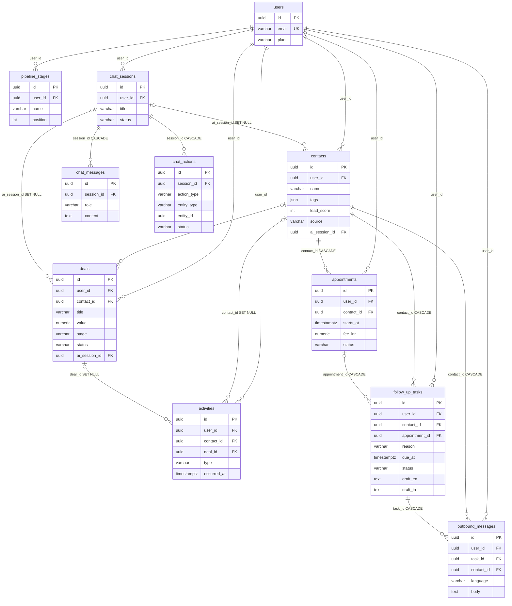

# LivoCRM Architecture

## 1. Overview

LivoCRM is a single-owner CRM: each registered account owns its contacts, deals, activities, pipeline
stages, chat sessions, appointments and follow-up tasks (every row carries `user_id`, and every query
filters on it). It has a Kanban pipeline, a contact and activity log, KPI analytics, and an AI chat
assistant ("Livo") that turns a conversation into validated CRM records after the user confirms them.
A clinic follow-up desk sits on top: appointments, a follow-up queue with AI-drafted English and Tamil
messages, and a recovery engine that creates reminder and no-show tasks. Primary actors are the account
owner (browser SPA), the Groq LLM API (optional; deterministic fallbacks exist), and an operator who runs
the demo-seed CLI. An AWS cloud pipeline (`cloud/`) for no-show modelling exists as code; the app does
not call it at runtime and it has not been deployed.

## 2. Tech Stack

- **Language:** Python 3.12 (backend, cloud), TypeScript 5.9 strict (frontend)
- **Backend:** FastAPI 0.115.0, Uvicorn 0.30.0, Pydantic 2.9 + pydantic-settings 2.5, SQLAlchemy 2.0.35
  async + asyncpg 0.29, Alembic 1.13, PyJWT 2.15.1, bcrypt 4.1.3, httpx 0.28.1, redis-py 8.1.0
- **Database:** PostgreSQL 16.15 (`postgres:16.15-alpine`), 11 tables, Alembic revisions 0001-0010
- **Cache / ephemeral state:** Redis 7.4.11 (chat context, chat locks, rate-limit counters, WS tickets)
- **Frontend:** React 19, Vite 8, React Router 7, Zustand 5, Axios, Zod 4, Tailwind CSS 4, shadcn/ui on
  Radix, Recharts 3, Framer Motion 12, self-hosted Fontsource (Geist, Noto Sans Tamil)
- **Edge / infra:** Nginx 1.27 gateway, `nginx:alpine` serving the SPA, Docker Compose; prod override
  adds Caddy for TLS (`cloud/deploy/`)
- **AI / ML:** Groq OpenAI-compatible `/chat/completions` (`openai/gpt-oss-20b` fast,
  `openai/gpt-oss-120b` smart) via httpx; legacy AWS Bedrock Converse via boto3; scikit-learn 1.5
  RandomForest lead scorer (`backend/ml/model.pkl`, built at image build time)
- **Cloud (offline, not deployed):** AWS SAM, Lambda (Python 3.12) ETL and score functions, S3,
  SageMaker scikit-learn training, ECR, SSM Parameter Store, GitHub Actions with OIDC

## 3. Services & Responsibilities

Compose services (`docker-compose.yml`):

- `nginx` - single public entry on `:3500`; routes `/api/*` and `/ws/*` to backend, `/` to frontend;
  edge rate limits, security headers, `/healthz`
- `frontend` - Vite build served by `nginx:alpine`; SPA with index.html fallback; not published to host
- `backend` - FastAPI on Uvicorn `:8000` (internal only); runs `alembic upgrade head` on start
- `db` - PostgreSQL 16; system of record; not published to host
- `redis` - password-protected; chat context (1 h TTL), chat turn lock (30 s), rate-limit counters,
  WebSocket tickets (30 s); `allkeys-lru` at `REDIS_MAXMEMORY`
- `pgadmin` (profile `dev`) - database GUI bound to `127.0.0.1:5050`
- `db-test`, `backend-test` (profile `test`) - tmpfs Postgres on an internal network; backend pytest image

Backend modules (`backend/app/`):

- `main.py` - app factory, CORS, DB-error to HTTP mapping (409 / 422), global 500 handler, router mounts
- `routers/` - HTTP and WebSocket endpoints (one module per resource; see `docs/API.md`)
- `dependencies.py` - `get_db`, `get_current_user` (JWT to `User`)
- `services/ai_engine/` - chat state machine: orchestrator, intent classifier, data extractor, question
  generator, prompts
- `services/llm/` - Groq client and per-key load-balancing pool (`key_pool.py`)
- `services/bedrock_service.py` - provider dispatch (`chat_completion`), legacy Bedrock, insights fallback,
  process-wide LLM semaphore (`llm_slots`, 8 slots)
- `services/session_manager.py` - Redis chat context and per-session turn lock
- `services/recovery.py` - follow-up task generator, KPI summary, opt-in scheduler loop
- `services/draft_service.py` - EN/TA message drafts with template fallback
- `services/ws_tickets.py`, `services/rate_limit.py`, `services/redis_client.py` - WS tickets, Redis
  fixed-window limiter, shared Redis client
- `services/ownership.py` - `require_owned()` tenant check for foreign-key references
- `services/auth_service.py` - bcrypt, JWT create/verify
- `services/analytics_cache.py` - per-process KPI snapshot pushed after chat saves
- `services/lead_scoring.py` - loads `ml/model.pkl`, scores one contact
- `services/session_naming.py`, `services/demo_seed.py`, `services/seed_service.py` - chat titles, demo
  clinic data, default pipeline stages on register
- `logging_config.py` - root handler that masks emails, phone numbers and URL query strings
- `cli.py` - `python -m app.cli seed-demo --email <address>`

Frontend (`frontend/src/`): `pages/` (Today, Appointments, Contacts, Pipeline, Chat, Reports, Settings,
Login, Register), `api/` (Axios client plus one module per resource), `hooks/useWebSocket.ts` (ticket
handshake and reconnect), `stores/` (Zustand: auth, chat, locale, theme, UI), `i18n/` (en, ta).

Cloud (`cloud/`, offline): `lambdas/etl` (raw CSV to curated Parquet), `lambdas/score` (model inference),
`ml/train.py` (SageMaker: logistic regression vs gradient boosting), `export_anonymised.py` (HMAC ids).

## 4. Full Application Flow

```text
 Browser (React SPA)
   │  REST JSON + WebSocket
   ▼
 nginx :3500 ── security headers, limit_req (auth 10/min, api 20/s), /healthz
   │
   ├── /              → frontend container (static SPA, index.html fallback)
   ├── /api/*         → backend :8000   (REST)
   └── /ws/*          → backend :8000   (WebSocket upgrade)
                          │
                          ▼
              FastAPI router
                 │  Depends: get_current_user (JWT), get_db, rate_limit()
                 ▼
              service / ORM query  (ownership filter on every row)
                 │
     ┌───────────┼──────────────┬───────────────────┐
     ▼           ▼              ▼                   ▼
 PostgreSQL   Redis          Groq API           Bedrock (legacy,
 16 (ORM,     ctx, locks,    /chat/completions  LLM_PROVIDER=bedrock
 asyncpg)     limits, tickets   (httpx, pool)    only)
     │           │              │                   │
     └───────────┴──────┬───────┴───────────────────┘
                        ▼
              JSON response  ─► nginx ─► browser
              WS events      ─► nginx ─► browser (dashboard_update,
                                         entity_created, ai_typing)
```

Errors: validation 422, auth 401, ownership 404, conflicts 409, rate limit 429 with `Retry-After`,
unhandled 500 with a generic body. Logs carry ids, counts and exception types, not message text; the
root log handler also masks emails, phone numbers and URL query strings (SEC-13).

## 5. Backend Architecture

```text
 routers/*.py            HTTP + WebSocket endpoints (thin)
   │ schemas/* (Pydantic in/out), dependencies.py (auth, db session)
   ▼
 services/*              business logic
   │  ai_engine/Orchestrator ──► intent_classifier, data_extractor,
   │                             question_generator, prompts
   │  recovery, draft_service, demo_seed, ownership, rate_limit,
   │  session_manager, ws_tickets, analytics_cache, lead_scoring
   │          │                                │
   │          ▼                                ▼
   │  bedrock_service.chat_completion     redis_client.get_redis()
   │     │ LLM_PROVIDER=groq (default)           │
   │     ▼                                       ▼
   │  llm/groq_client ──► llm/key_pool      Redis 7.4
   │     │                                 (keys: livocrm:ctx:*,
   │     ▼                                  livocrm:lock:chat:*,
   │  Groq API                              livocrm:rl:*,
   │                                        livocrm:wsticket:*)
   ▼
 models/* (SQLAlchemy 2 ORM, Mapped[]) ─► database.py (async engine)
                                             │
                                             ▼
                                        PostgreSQL 16
```

There is no separate repository layer: routers and services issue SQLAlchemy queries directly through
the session from `get_db`. `POST /chat/sessions/{id}/message` and `POST /follow-ups/{id}/draft` commit
before the LLM call, so the pooled connection is not held across it. `POST /ai/insights` runs its
aggregate queries first and then calls the LLM without committing, so it does hold its session. Blocking
LLM calls run through `asyncio.to_thread` inside `async with llm_slots` (8 concurrent calls per process).

## 6. Data Models

Eleven tables. Migrations 0001-0002 create the eight core and chat tables. 0003-0009 add provenance
columns, indexes, CHECK constraints, the case-insensitive email index and the `failed` chat-action status.
0010 adds the three clinic tables (`appointments`, `follow_up_tasks`, `outbound_messages`).

- `users` - account; `email` unique on `lower(email)`; `plan` CHECK `free|pro|enterprise`
- `contacts` - owned by a user; `tags` JSON; `lead_score`; `source` (`manual|ai_chat`); optional `ai_session_id`
- `deals` - pipeline item; optional `contact_id`; `stage` (6 values) and `status` (`active|won|lost`) CHECKs;
  `value` NUMERIC(12,2)
- `activities` - call/email/meeting/note/task log; optional `contact_id` and `deal_id`
- `pipeline_stages` - per-user stage list; unique `(user_id, name)`
- `chat_sessions` - conversation; `status` `active|archived|closed`
- `chat_messages` - `role` `user|assistant`, optional `intent`
- `chat_actions` - audit of chat writes; `status` `pending|confirmed|rejected|completed|failed`;
  `entity_id` is a plain UUID with no FK, so it survives deletes
- `appointments` - visit; `starts_at` (timestamptz), `fee_inr` NUMERIC(10,2) >= 0, `status`
  `booked|confirmed|completed|no_show|cancelled|rescheduled`; index `(user_id, starts_at)`
- `follow_up_tasks` - `reason` `reminder_24h|reminder_2h|no_show_recovery|lead_followup|manual`;
  `status` `pending|done|skipped`; `channel` = `simulated`; unique `(appointment_id, reason)` makes
  generation idempotent; drafts `draft_en`, `draft_ta`
- `outbound_messages` - approved message, `language` `en|ta`, `status` = `sent`, `channel` = `simulated`



## 7. External Integrations

- **Groq API** (default LLM). `POST {GROQ_BASE_URL}/chat/completions`. Used for intent classification,
  field extraction, follow-up questions, confirmation text, general chat, chat titles, message drafts
  (fast model) and dashboard insights (smart model). Keys are pooled (`services/llm/key_pool.py`). Details:
  `docs/ai.md`.
- **AWS Bedrock Converse** (legacy). Used only when `LLM_PROVIDER=bedrock` and `BEDROCK_ENABLED=true`.
  `boto3` is imported at module load, so the package is required even when Groq is active.
- **Messaging channels: none.** Follow-up messages are recorded in `outbound_messages` with
  `channel=simulated`. Nothing is sent to a patient or customer.
- **WebSocket clients.** Dashboard and per-chat-session sockets. A user may hold at most 5 open sockets
  (close 4029 beyond that). The registry is in-process, so it is per worker.
- **Lead scorer model.** Local `backend/ml/model.pkl` (RandomForest, 100 trees, 7 features), created by
  `ml/generate_data.py` and `ml/train_scorer.py` during the image build. Not a network service.
- **AWS cloud pipeline (offline).** S3 (`raw/`, `curated/`, `models/`, `scoring/`), Lambda ETL (03:00 IST
  via `cron(30 21 * * ? *)`), Lambda score (04:00 IST via `cron(30 22 * * ? *)`), SageMaker training,
  ECR, SSM, GitHub Actions OIDC deploy (`.github/workflows/deploy.yml`, manual trigger only). The app
  does not read `scoring/results/` yet. Details: `docs/cloud/architecture.md`.

## 8. Environment & Config

Full list with defaults: `docs/docker.md`. Grouped by concern (values come from `.env`; never commit it):

- **Database:** `DATABASE_URL` (asyncpg URL to host `db`), `POSTGRES_USER`, `POSTGRES_PASSWORD`, `POSTGRES_DB`
- **Redis:** `REDIS_URL` (must embed `REDIS_PASSWORD`), `REDIS_PASSWORD`, `REDIS_MAXMEMORY`
- **Auth:** `SECRET_KEY` (32+ chars, required), `ALGORITHM` (HS256), `ACCESS_TOKEN_EXPIRE_MINUTES`
- **HTTP:** `CORS_ORIGINS`, `ENABLE_DOCS` (serves `/api/docs` only when true), `LOG_LEVEL`
- **Recovery:** `ENABLE_SCHEDULER` (60 s generator loop; keep false when running several workers)
- **LLM provider:** `LLM_PROVIDER` (`groq` | `bedrock`), `GROQ_API_KEYS` (one or more, comma-separated),
  `GROQ_MODEL_FAST`, `GROQ_MODEL_SMART`
- **Legacy Bedrock:** `AWS_ACCESS_KEY_ID`, `AWS_SECRET_ACCESS_KEY`, `AWS_DEFAULT_REGION`, `BEDROCK_LLM_MODEL`
- **Admin tooling:** `PGADMIN_DEFAULT_EMAIL`, `PGADMIN_DEFAULT_PASSWORD` (dev profile only)
- **Frontend build:** `VITE_API_URL` (empty in compose; the client falls back to `/api`)

Settings read by `backend/app/config.py` but absent from `.env.example`: `GROQ_API_KEY` (single-key
fallback), `GROQ_BASE_URL`, `LLM_TIMEOUT_S`, `LLM_TEMPERATURE`, `BEDROCK_ENABLED`, `BEDROCK_MAX_TOKENS`,
`BEDROCK_TEMPERATURE`. Startup fails if `SECRET_KEY` is shorter than 32 characters or `DATABASE_URL` is empty.

## 9. Auth & WebSocket Ticket Flow

JWTs are never placed in a URL. Browsers cannot set headers on a WebSocket handshake, so the client
trades its JWT for a single-use ticket first.

```text
 Browser                           Backend                         Redis
   │ POST /api/auth/login             │                               │
   │ {email, password}  ────────────► │ rate_limit login 5/60s        │
   │                                  │ bcrypt (DUMMY_HASH if unknown)│
   │ ◄──────────── {access_token}     │                               │
   │                                  │                               │
   │ POST /api/ws/ticket              │                               │
   │ Bearer JWT + {channel, sid?} ──► │ chat: session must be caller's│
   │                                  │ SET livocrm:wsticket:<t>      │
   │                                  │   claims  EX 30  ───────────► │
   │ ◄──── {ticket, expires_in: 30}   │                               │
   │                                  │                               │
   │ WS /ws/dashboard/<uid>?ticket=t  │ GETDEL ticket  ─────────────► │
   │ WS /ws/chat/<sid>?ticket=t ────► │ ◄──────────── claims (once)   │
   │                                  │ checks: channel, user or sid  │
   │ ◄── dashboard_update, entity_created, ai_typing                  │
   │ ──► "ping"   ◄── "pong"          │                               │
```

Close codes: `4001` missing ticket, `4002` invalid, used or expired, `4003` wrong channel, user or
session, `4029` per-user socket cap (5).

## 10. AI Layer

`chat_completion()` in `services/bedrock_service.py` is the single entry point. It dispatches on
`LLM_PROVIDER`: `groq` calls `services/llm/groq_client.groq_chat`, which picks a key from `KeyPool`,
fails over on 429, 401/403 and 5xx, and raises `GroqServiceError` when no key can serve. Every caller
catches `BedrockServiceError` (the common base class) and uses a deterministic fallback. Full behaviour,
the key-pool rules and the health endpoint: `docs/ai.md`.

## 11. Chat Confirm Flow

The assistant never writes a record on the first message. It collects fields, shows a summary and waits
for a yes or no in the next message. The reply is parsed negation-first (`parse_confirmation`), so
"no, don't save" cannot save. A confirm endpoint is deferred.

```text
 IDLE ──message──► CLASSIFYING  (intent via LLM; failure → GENERAL_CHAT)
   │
   ├─ GENERAL_CHAT, QUERY_DATA, MULTI_INTENT ──► reply, state stays IDLE
   │
   └─ ADD_* / UPDATE_* / LOG_ACTIVITY
        │  if a record was just saved, follow-up details become UPDATE_*
        ▼
      COLLECTING ── extract fields (merge into collected_data)
        │  missing required? ──► ask one question, stay COLLECTING
        ▼
      CONFIRMING ── summary via LLM (fallback: bullet list)
        │  reply → parse_confirmation()
        ├─ "confirm" ──► SAVING ──► router validates with ACTION_MODELS
        │                  ├─ valid: SAVEPOINT write, ChatAction completed,
        │                  │   COMMIT, then Redis ctx reset to IDLE,
        │                  │   WS entity_created + dashboard_update
        │                  └─ invalid: ChatAction failed, bad fields
        │                      dropped, back to COLLECTING with a question
        ├─ "reject"  ──► COLLECTING ("What would you like to change?")
        └─ "unclear" ──► re-extract from the reply (may switch intent)
```

Per-session turns are serialised by a Redis lock (`SET NX PX 30000`). A second message while a turn
runs gets 409. Context lives in Redis under `livocrm:ctx:<user>:<session>` with a 1 h TTL; a Redis
outage starts a fresh context and logs a warning.

## 12. Recovery Engine Flow

Recovery turns appointment state into follow-up tasks. Generation is idempotent because
`(appointment_id, reason)` is unique, so repeated runs insert nothing new.

```text
 Trigger: POST /api/recovery/run (30/min per user)
          or scheduler tick every 60 s (ENABLE_SCHEDULER=true)
          │
          ▼  generate_recovery_tasks(now)
   1. status in (booked, confirmed) AND starts_at < now - 1 h
        → appointment.status = no_show
        → task no_show_recovery, due now
   2. status in (booked, confirmed) AND starts_at > now
        → task reminder_24h due at starts_at - 24 h   (created once due)
        → task reminder_2h  due at starts_at - 2 h    (created once due)
   INSERT ... ON CONFLICT (appointment_id, reason) DO NOTHING
          │
          ▼  follow_up_tasks (status = pending) → Today queue
   POST /api/follow-ups/{id}/draft    LLM EN+TA JSON, template fallback
          │                           (prompt has purpose and IST time only)
   POST /api/follow-ups/{id}/approve  conditional UPDATE pending → done
          │                           + outbound_messages row (simulated)
   POST /api/follow-ups/{id}/skip     conditional UPDATE pending → skipped

 GET /api/recovery/summary?days=30
   appointments, no_shows, no_show_rate, pending_tasks, messages_sent,
   recovered_inr = sum of fee for completed appointments whose contact had
   an approved no_show_recovery message created before that appointment row
   (attribution, not proof of cause)
```

The scheduler is off by default. Each tick loops over every user with an open appointment and runs the
same generator; a failed tick is logged and retried on the next tick.
