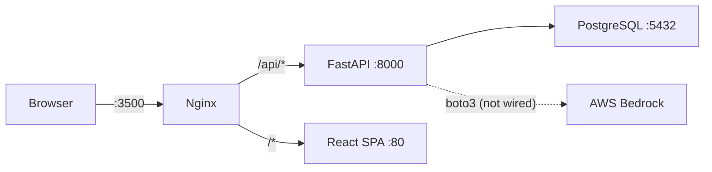

# LivoCRM — Integration Analysis Report

## Architecture Overview



---

## Integration Status

| Component | Status | Details |
|-----------|--------|---------|
| **Docker Containers** | ✅ All Running | db, backend, frontend, nginx — all healthy |
| **Nginx → Frontend** | ✅ Working | `http://localhost:3500/` serves React SPA HTML |
| **Nginx → Backend** | ✅ Working | `/api/*` proxied to backend:8000 |
| **Backend → DB** | ✅ Working | Alembic migrations ran, 6 tables created |
| **Health Endpoint** | ✅ Working | `GET /api/health` → `{"status":"ok"}` |
| **Auth (Register/Login)** | ❌ Broken | passlib/bcrypt crash on Python 3.12 |
| **Frontend → Backend API** | ⚠️ Partial | Client configured correctly, but auth is broken so no logged-in flows work |
| **AI / Bedrock Integration** | ⚠️ Not Wired | boto3 installed, credentials valid, but **no endpoint actually calls Bedrock** |
| **ML Lead Scoring** | ⚠️ No Model | Code loads `ml/model.pkl` — file likely doesn't exist in container, returns `{"score":0}` |

---

## Database ✅

All 6 tables exist in PostgreSQL:

| Table | Purpose |
|-------|---------|
| `users` | Auth & user profiles |
| `contacts` | CRM contacts |
| `deals` | Sales deals with pipeline stages |
| [activities](file:///home/lebi/projects/livocrm/backend/app/routers/activities.py#17-34) | Interaction logs (calls, emails, meetings) |
| `pipeline_stages` | Deal pipeline configuration |
| `alembic_version` | Migration tracking |

---

## Bedrock API Test ✅

> [!IMPORTANT]
> **The Bedrock API credentials work** — tested from inside the backend container.

```
Model: us.meta.llama4-scout-17b-instruct-v1:0
Region: us-east-1
Result: Successfully generated 50 tokens from Llama 4 Scout
```

**However, no API endpoint actually calls Bedrock.** The `/api/ai/insights` endpoint returns **hardcoded placeholder** strings — it never invokes `boto3` or the Bedrock runtime.

---

## Issues Found

### 1. ❌ Auth Registration Crash (Critical)

```
ValueError: password cannot be longer than 72 bytes, truncate manually if necessary
```

- **Root cause:** `passlib 1.7.4` + `bcrypt 5.0.0` incompatibility on Python 3.12
- **Fix:** Pin `bcrypt<4.1` in [requirements.txt](file:///home/lebi/projects/livocrm/backend/requirements.txt), or switch to `bcrypt` directly instead of passlib

### 2. ⚠️ Bedrock Not Wired Into Any Endpoint

- `boto3` is installed and credentials are valid
- But [ai.py](file:///home/lebi/projects/livocrm/backend/app/routers/ai.py) `/insights` returns hardcoded strings
- **No code imports boto3 or bedrock-runtime anywhere in the app**

### 3. ⚠️ ML Model File Missing

- [lead_scoring.py](file:///home/lebi/projects/livocrm/backend/app/services/lead_scoring.py) loads `ml/model.pkl` at runtime
- If the `.pkl` file wasn't trained/included in the Docker image, scoring returns `{"score": 0, "label": "unknown"}`

### 4. ⚠️ Frontend [.env](file:///home/lebi/projects/livocrm/.env) Mismatch (Minor)

- [frontend/.env](file:///home/lebi/projects/livocrm/frontend/.env): `VITE_API_URL=http://localhost:8000/api` (points directly to backend)
- In production Docker build, this gets baked in — but the nginx proxy at `:3500` handles routing via `/api` fallback, so it works at runtime

### 5. ⚠️ CORS Missing `localhost:3500`

- [main.py](file:///home/lebi/projects/livocrm/backend/app/main.py) allows origins: `localhost:5173`, `localhost:3000`, `localhost`
- The actual nginx entry point is `localhost:3500` — **not in the CORS list** (but proxied traffic uses `Host: localhost` so it works through nginx)
