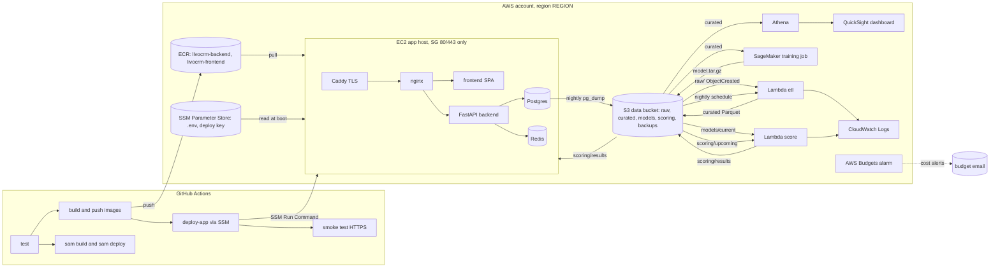

# Cloud architecture (IA3 Cloud Computing)

Status: the artifacts under `cloud/`, `.github/workflows/deploy.yml` and `cloud/deploy/` are written and
unit-tested. Nothing in this document has been deployed to AWS yet. Figures are placeholders until a
real run produces them. Placeholders: `<ACCOUNT_ID>`, `<REGION>`, `<BUCKET>` (`livocrm-data-<ACCOUNT_ID>-<REGION>`),
`<APP_DOMAIN>`.

## 1. Components

| Layer | What | Where it lives |
|---|---|---|
| App hosting | Compose stack (Postgres, Redis, FastAPI backend, React SPA, nginx) behind Caddy (TLS) on one EC2 host | `cloud/deploy/`, `docker-compose.yml` |
| Images | `livocrm-backend`, `livocrm-frontend` in ECR, tagged with the commit sha | `cloud/template.yaml` (ECR repos) |
| Data | One S3 bucket: `raw/`, `curated/`, `models/`, `scoring/`, `backups/` | `cloud/template.yaml` |
| ETL | Lambda `etl`: S3 ObjectCreated on `raw/` and a nightly schedule; writes Parquet | `cloud/lambdas/etl/` |
| ML | SageMaker scikit-learn training job; logistic-regression baseline vs gradient boosting | `cloud/ml/` |
| Scoring | Lambda `score`: loads the model from S3, returns `no_show_risk` 0-1; nightly schedule | `cloud/lambdas/score/` |
| Export | Script that turns appointment rows into the anonymised CSV | `cloud/export_anonymised.py` |
| Analytics | Athena table over `curated/`; QuickSight dashboard on top | section 5 |
| CI/CD | GitHub Actions with OIDC: test, build, push to ECR, SSM deploy, smoke test, `sam build && sam deploy` | `.github/workflows/deploy.yml` |

## 2. Diagram



## 3. Data flow

1. **Export.** The app's nightly job runs `cloud/export_anonymised.py` over the appointments table. Ids
   become HMAC-SHA256 digests (key in SSM). Names, phones, emails and notes are not read. Rows with no
   outcome are skipped. The output goes to `s3://<BUCKET>/raw/livocrm/<date>.csv`.
2. **Public dataset.** The Kaggle Medical Appointment No-Shows CSV is uploaded once to
   `s3://<BUCKET>/raw/kaggle/`. It is the training base because the app has little real history.
3. **ETL.** Each object under `raw/` triggers `etl`. The handler detects the header (Kaggle or LivoCRM),
   validates and cleans rows, counts drops by reason, engineers features (lead time days, weekday,
   scheduled hour, age band, reminder sent, prior no-shows) and writes
   `s3://<BUCKET>/curated/appointments/source=<kaggle|livocrm>/<stem>-<timestamp>.parquet`.
   The 03:00 IST schedule processes the newest `raw/livocrm/` export.
4. **Training.** `cloud/ml/launch_training_job.py` starts a SageMaker job on `curated/appointments/`.
   `train.py` logs test AUC, precision and recall for both candidates and saves the better one as
   `model.joblib` inside `model.tar.gz`.
5. **Promotion.** The artifact is copied to `models/no-show/current/model.tar.gz`, which `MODEL_KEY` points at.
6. **Scoring.** The app writes the upcoming appointments as JSON to `scoring/upcoming/latest.json`. At
   04:00 IST the `score` schedule scores that batch and writes `scoring/results/latest.json`. The app host
   role can read that prefix. Lambda can also be invoked directly with JSON and returns the scores.
7. **App.** The app shows `no_show_risk` as the risk chip and uses it to order reminders. The app-side
   reader is a Phase 2 task (see section 9).
8. **Analytics.** Athena reads `curated/`. QuickSight reads Athena.

## 4. Athena table

Run in the Athena console (region `<REGION>`), with the workgroup and results bucket set up once:

```sql
CREATE DATABASE IF NOT EXISTS livocrm;

CREATE EXTERNAL TABLE IF NOT EXISTS livocrm.curated_appointments (
  appointment_id string,
  patient_id string,
  scheduled_at timestamp,
  appointment_at timestamp,
  lead_time_days int,
  weekday int,
  scheduled_hour int,
  age int,
  age_band string,
  reminder_sent int,
  prior_no_shows int,
  no_show int,
  data_label string
)
PARTITIONED BY (source string)
STORED AS PARQUET
LOCATION 's3://<BUCKET>/curated/appointments/';

MSCK REPAIR TABLE livocrm.curated_appointments;
```

Check the table with `SELECT data_label, count(*), avg(no_show) FROM livocrm.curated_appointments GROUP BY data_label;`
Report each `data_label` separately.

## 5. QuickSight dashboard (manual steps)

1. QuickSight: sign up for the edition you can afford (see the cost table; check the free-trial terms on
   the pricing page before relying on them). Grant QuickSight access to the `<BUCKET>` bucket and to Athena.
2. Data source: Athena, workgroup `primary`, database `livocrm`. Dataset: `curated_appointments`.
   Import to SPICE if the data is small, otherwise use direct query.
3. Calculated fields: `no_show_rate = avg(no_show)`.
4. Sheet 1, "When no-shows happen": no-show rate by `weekday` (bar), by `lead_time_days` bucket (line),
   and a heat map of `weekday` x `scheduled_hour`. Filter on `data_label`.
5. Sheet 2, "Model": a small table built from `metrics.json` (upload it as a second dataset or type the
   numbers from your run). Show AUC, precision and recall for both candidates.
6. Sheet 3, "Recovery funnel": leave for the app data after Phase 2. Until then, use the in-app Reports
   page and export screenshots as the fallback.
7. Publish the dashboard and take screenshots for the report.

## 6. Cost estimate

**These are planning estimates, not measured costs.** They were written from public list prices as
recalled at authoring time, for the `<REGION>` region, and they must be checked in the AWS Pricing
Calculator before they go in the report. Replace each row with the real bill after one month.

| Item | Assumption | Estimate (USD / month) |
|---|---|---|
| EC2 t3.medium | 24x7, on-demand | about 35-40 |
| EBS gp3 20 GiB | 1 volume | about 2 |
| Public IPv4 address | one Elastic IP, attached | about 4 |
| ECR storage | under 2 GB, scan on push | under 1 |
| S3 storage and requests | under 1 GB, nightly writes | under 1 |
| Lambda etl and score | under 100 invocations/month, 1 GiB | within the free tier |
| SageMaker training | ml.m5.large, about 10 minutes per run, a few runs | under 1 per run |
| Athena | under 100 MB scanned per query | under 1 |
| QuickSight | one author seat | about 9-24 if you keep it past any trial; verify |
| CloudWatch Logs | short retention | under 1 |
| AWS Budgets | one budget | free within the free allowance; verify |
| **Total (estimate)** | | **about 45-65, excluding QuickSight trial terms** |

The budget alarm in `cloud/template.yaml` caps spend at `BudgetLimitUsd` (default 10 USD), so the
estimate is for the report, not a limit. If the host is t3.small, the EC2 line drops by roughly half.
Ask for the Pricing Calculator export and keep it with the report.

## 7. Security notes

- **Network.** The app security group allows 80 and 443 from anywhere and nothing else. There is no SSH
  key pair and no port 22; shell access is SSM Session Manager. Postgres and Redis are not published.
- **Instance metadata.** Launch the host with IMDSv2 required (`HttpTokens=required`) so a container
  cannot pick up the instance role through a v1 request.
- **Storage.** The data bucket has all four public-access blocks on, SSE-S3 default encryption, a bucket
  policy that denies non-TLS requests, and lifecycle expiry on scoring, backup and raw export prefixes.
  The bucket is `Retain` on stack delete.
- **Identity.** GitHub Actions uses OIDC with branch-scoped trust (`refs/heads/main`). There are no
  long-lived AWS keys in the repo or in GitHub. The two deploy roles are split: one for ECR and SSM, one for
  SAM. The SAM role is limited to resources whose names start with `livocrm-`.
- **Least privilege.** The ETL role reads `raw/*`, writes `curated/*` and lists only `raw/`. The score role
  reads `models/*` and `scoring/upcoming/*` and writes `scoring/results/*`. The app host role reads
  `/livocrm/prod/*` parameters and the two repos, and writes `backups/*`.
- **Secrets.** The app `.env` and the repo deploy key are SecureString parameters, read only on the host
  (root-only files, mode 0600). Nothing is written into the repo or the user-data script.
- **Supply chain.** ECR scan on push. Python dependencies are pinned in every `requirements*.txt`.
  GitHub Actions versions are pinned to release tags; pin them to commit SHAs before the final submission.
- **Model artifacts.** The score Lambda unpickles `model.joblib`. It loads only from the data bucket,
  which only the training job and the promotion step can write to.
- **Known gaps.** No CloudTrail or GuardDuty configuration is in this repo. No WAF in front of Caddy.
  Caddy's rate limiting is not configured; the app's Redis rate limiter is the control in place.

## 8. DPDP note: what leaves the app

- The clinic is the data fiduciary under the Digital Personal Data Protection Act; LivoCRM is the
  processor. The clinic gives notice and consent for each purpose. The cloud pipeline is one purpose
  (no-show prediction), and it must be named in that notice.
- **Only the nightly export leaves the app** (plus the scoring batch and its results). The export contains
  HMAC digests of appointment and patient ids, appointment and booking timestamps, age, a reminder flag and
  the outcome. It contains no name, phone number, email, address or free-text note. The export script
  reads only the whitelisted columns.
- **Careful wording for the report.** Hashed ids keyed with a secret are pseudonymised, not anonymised.
  Age plus timestamps can still single out a person, and the key holder can re-link the records. Under
  DPDP this is still personal data, so the report must say "pseudonymised and minimised", not "anonymised".
  The key stays in SSM Parameter Store and is never sent to AWS for the pipeline.
- Public Kaggle data contains no personal identifiers and is labelled `kaggle_public` in the data.
- The score result returns to the app as a risk number per appointment id. It is attached to a patient
  inside the app, so it stays within the same purpose.
- Retention: raw exports expire after 90 days, scoring I/O after 30 days, backups after 30 days.
  Curated Parquet has no expiry; add one before any real clinic data goes in.

## 9. Open items

- The app does not yet call `score` or read `scoring/results/`. That is Phase 2 integration work.
- The nightly export job that writes `raw/livocrm/` is part of the app's cron, not this repo yet.
- The SageMaker execution role and the EC2 host are created by hand (see `cloud/deploy/README.md`).
- Lambda log retention is the default (never expire). Set a retention on the log groups once they exist.
